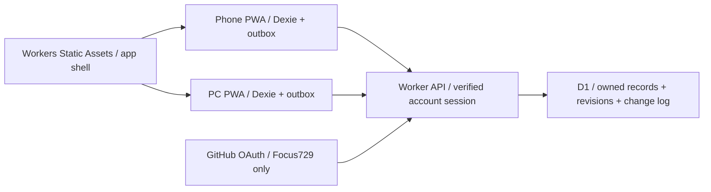

# Cloudflare hosting and cross-device profile plan

Date: 2026-11-02. Status: explicitly approved by Pavel on 2026-11-02; CF-M1 started.

## Outcome and decisions

Pavel opens FitnessMy on phone and PC, signs in to the same private account and sees the same history. Logging remains usable offline on a previously initialized trusted device. Cloudflare hosts the app and backend; GitHub remains the public source repository, not the production host.

Confirmed: Cloudflare selected; GitHub Pages will be retired after migration; access is for Pavel alone. He reports being signed in to the Cloudflare dashboard by email. This is not evidence of application authentication or deploy credentials.

Approved implementation (amended 2026-11-02): Workers Static Assets + a Worker API + D1; GitHub OAuth restricted to the immutable ID of Focus729. Pavel explicitly approved replacing email OTP with GitHub login after refusing any payment-card requirement. No public signup, shared household access, password database or email-delivery service. Preserve direction B, React/TypeScript/Dexie, Russian/English and phone/desktop layouts. Keep independent local profiles under one account when importing; never assume two local profiles represent one history.

Cost boundary: Workers Free/D1 Free only, with no payment card. Cloudflare Access/Zero Trust is excluded: its official onboarding requires payment details even on Free. No paid plan, domain purchase, payment authorization or overage-bearing service activation. Stop only the affected provisioning step if it requires billing. R2 is not required for this increment.

## Existing implementation and release facts

- Source: public https://github.com/Focus729/FitnessMy, branch `master`; metadata rechecked 2026-11-02. Preserve repository visibility and history. No branch/PR overhead is required for this solo change.
- Existing site: https://focus729.github.io/FitnessMy/; Pages remains enabled. Established deployment history is in `RELEASE.md`. Local planning edits are uncommitted; do not overwrite them.
- Current app: `src/data/profiles.ts` stores the registry in localStorage; `src/data/db/schema.ts` creates per-profile Dexie databases. The PIN is only a local accidental-access barrier.
- Repository interfaces in `src/data/repositories` isolate the UI from storage. Extend these rather than rewriting feature screens.
- `src/data/backup.ts` supports validated backup preview/import and recovery. Timestamp-based backup merging is not a sufficient concurrent synchronization protocol.
- `vite.config.ts` already accepts `APP_BASE_PATH`; the release script still forces `/FitnessMy/` and must change for Cloudflare `/`. PWA wording currently says data stays only on-device and must be corrected.
- No `.github` workflow directory currently exists locally. The release gate is sequential and does not deploy; retain and extend this fail-closed behavior.
- Cloudflare workers.dev subdomain `hpavel729` and Workers Free were verified. Created `fitnessmy-staging` D1 (49e061b0-2191-453d-891a-abbd8c269e21), remote read check passed. Proposed Workers: `fitnessmy` production and `fitnessmy-staging` staging; production database remains to be created. GitHub OAuth application 3985550 was registered after explicit action-time permission; its Client Secret is intended only for Worker secrets, never source or backups.

## Architecture

### Authentication and local privacy

Use GitHub authorization-code OAuth with S256 PKCE, a short-lived one-time state bound to an HttpOnly browser cookie, exact callback URLs, and no requested repository/email scopes. Verify identity server-side using GitHub's user API and allow only immutable GitHub ID 43194562 (Focus729), not a changeable login string. Issue a random first-party session token in a Secure/HttpOnly/SameSite cookie; store only its SHA-256 hash and expiry in D1. Do not persist provider tokens. Keep the Client Secret only in Worker secret settings. Reject broader-than-expected provider scopes. Enforce ownership for every record, attachment and operation; identity allowlisting alone does not replace row ownership checks.

Use a public, data-free static shell with session-protected `/api/*` and `/auth/login`, `/auth/callback`, `/auth/logout` on the same origin. This lets an installed PWA launch offline without caching login responses. CF-M1 must prove the real GitHub callback, authenticated fetch, logout, expiry and installation. Account access remains protected by the Worker on every path, including workers.dev and preview URLs; previews remain disabled.

Keep auth/API routes outside service-worker navigation fallbacks and caches. Handle 401/403 or unexpected HTML as reauthentication/failure, not sync success. Use same-origin request checks/CSRF defense for cookie-authenticated writes; never expose D1 credentials to the browser. Rate-limit abusive requests and bound payloads. Logs contain operation IDs and error categories, not bodies, measurements, OAuth codes, tokens or private email.

Explicit logout locks UI immediately and removes account data after pending writes have synchronized or the user has exported them; never silently drop queued writes. A session expiring while offline may retain the explicitly trusted device's local workspace, but no server access resumes without authentication. Explain that offline cached data is not end-to-end encrypted or remotely erasable while disconnected. Existing local-only profiles remain accessible through an explicit local mode, not automatically linked to an online identity.

### Data and synchronization contract

Preserve canonical metric values and existing entity IDs inside a profile namespace. Use D1 account/profile ownership tables, versioned entity envelopes (validated type/payload), per-profile change sequence, idempotency receipts, tombstones, import manifests and attachment metadata/chunks. A profile migration has a stable source identity; a name match never merges profiles. Server sequence/revision decides order; device clocks are not conflict authority.

Every repository mutation writes the local record and a durable outbox operation in the same Dexie transaction, including undo, imports, reset and related workout/set changes. Each operation carries a stable ID and expected server revision. Push bounded batches; acknowledge only after D1 commits. Apply related writes/change-log/receipt atomically with guarded SQL and verified D1 batch semantics. Duplicate retries return the original result; a lost HTTP response cannot duplicate a meal or workout. Derive totals from canonical child records instead of independently synchronizing aggregates.

Pull deltas by server cursor; persist applied rows and cursor atomically. Initial snapshots need a consistent watermark and paginated continuation so concurrent changes cannot be missed. Retry transient failures with backoff; retain pending writes on auth, quota, server or network failure. Use sync on app launch/focus, successful edits and reconnect, plus manual retry. No reliance on background execution while the mobile app is closed. Online acceptance target: after both apps are foregrounded on a healthy connection, changes appear within 10 seconds in synthetic two-device tests.

For concurrent edits to the same record, retain both versions and show a comparison/choice; do not silently use client timestamp last-write-wins. Distinct-record edits merge. Delete-versus-edit is an explicit conflict, with deletion retained until resolved. Keep tombstones/change receipts for the initial bounded personal dataset; define a safe full-resync protocol before later compaction. Restoring an old backup cannot silently resurrect deleted records. A synchronized profile replacement is a versioned, explicitly reviewed change set with a recovery snapshot, never an unconditional server wipe.

Inventory every current table and setting in CF-M2. Synchronize user-created foods/recipes/dishes, diary/water/fasting/substances, plans/shopping state/templates, custom exercises/routines, workouts/sets/cardio, body/sleep/check-ins, habits/logs and user progress state. Built-in catalogs remain versioned app assets. Keep local drafts, device preferences where appropriate, local PIN, AI keys and Drive tokens device-local; document the precise classification. Resolve derived achievement/XP events idempotently to prevent duplicate rewards.

Preserve existing user attachments without requiring R2: use resumable D1 chunks below the 2 MB row limit, owner-scoped reads, hashes and a finalized-upload marker. Do not publish records pointing to incomplete attachments. Inventory total bytes before upload; expose insufficient space without deleting originals or silently omitting files. If actual data cannot reasonably fit the free 500 MB database budget, report it and revise storage choice before migration. Built-in exercise images remain static assets.

## Requirements, tasks and evidence

All tasks start `Planned`; implemented / verified / released are separate states. Record concrete test files, reports, source SHA and deployed Worker version as work proceeds.

| Requirement | Expected result / acceptance | Tasks | Evidence now |
| --- | --- | --- | --- |
| CF-01 / SYNC-01 | Same authorized account loads the same selected profile in two independent browsers; another GitHub ID cannot enter | T1, T2, T5 | Auth implemented; 12 local SQLite-backed tests passed; live flow pending |
| CF-02 / SYNC-02 | All inventoried user entities synchronize create/edit/delete/undo with no duplicates; observed convergence within 10 s under test conditions | T3, T4, T5 | Planned |
| CF-03 / SYNC-03 | Offline edits survive reload and reconnect; first online initialization is clearly required | T1, T4, T8 | Planned |
| CF-04 / SYNC-04 | Forged/expired tokens and foreign account/profile/attachment IDs cannot read or mutate records | T2, T3, T8 | Planned |
| CF-05 / SYNC-05 | Old-origin backup imports resume safely; repeated imports do not duplicate and counts/references/attachment hashes agree | T6, T10 | Planned |
| CF-06 / SYNC-06 | Pending/failed/reauth/conflict states are visible; divergent versions retained; stale devices do not resurrect deletions | T4, T5, T8 | Planned |
| CF-07 / SYNC-07 | Logout/account change hides cached history; unsent edits are recoverable before cache deletion | T2, T5, T8 | Planned |
| CF-08 / SYNC-08 | Backup export/restore and isolated recovery rehearsal work after sync; restore cannot wipe live data silently | T6, T7, T8 | Planned |
| CF-09 | Cloudflare serves assets/API at the verified canonical URL with matching build SHA; Pages later disabled | T1, T9, T10 | Planned |
| CF-10 | RU/EN desktop/phone login guidance, migration, status, conflict and error screens usable in both themes | T5, T8 | Planned |
| CF-11 | New-origin PWA installs, reloads offline, updates safely and retains active workout/rest deadline | T1, T5, T8, T10 | Planned |
| CF-12 | Free limits visible operationally; quota failures preserve writes; no paid service activation | T1, T7, T9 | Planned |
| CF-13 | Failed test/build/migration prevents publication; production/staging resources are isolated | T7, T9 | Planned |
| CF-14 | Existing nutrition/gym/body/habit/progress/backup flows remain functional; attachments and unit conversions preserved | T3, T6, T8 | Planned |

## Ordered increments

### CF-M0 — Planning (complete; not implementation)

Inspected affected code and release facts; verified official hosting, auth and storage capabilities. Pavel approved the complete plan on 2026-11-02 and subsequently explicitly approved GitHub login instead of email OTP, with no card/payment.

### CF-M1 — Account, target and technical proof

- **T1 (CF-01,03,09,11,12)**: verify account permissions/free entitlements, capture non-secret target identifiers, configure Focus729's immutable GitHub ID and exact OAuth callback. Create isolated free staging resources and a minimal auth/PWA/D1 proof. Check real PC/mobile network reachability, login, offline relaunch and expiry. Expected: viable target and evidence before full implementation. State: In progress; Workers Free/CLI/D1 verified, GitHub app created, secret provisioning and live flow pending.
- Gate: authenticated paths cannot be bypassed; API/auth never receives SPA HTML fallback; no card or paid activation required. Pin compatible Wrangler/runtime dependencies only after official compatibility checks. If prerequisites fail, report the exact gap while continuing independent local work.

### CF-M2 — Protected backend and complete data contract

- **T2 (CF-01,04,07)**: implement identity verification, account mapping, profile ownership, session/logout behavior and request validation. Test forged/missing/expired/wrong-audience tokens, alternate URLs and simulated second account. Expected: only owned data accessible. State: Planned.
- **T3 (CF-02,04,14)**: inventory schemas, classify synced/local/derived data, implement versioned D1 schema and bounded atomic API operations, attachment chunks and isolated local migrations. Test rollback, invalid references, payload sizes, ownership and retry receipts. Expected: stable contract covering every existing data type. State: Planned.
- Gate: actual D1 runtime integration tests prove concurrent compare-and-set, atomicity and idempotency; mocks alone are insufficient.

### CF-M3 — Offline synchronization engine

- **T4 (CF-02,03,06)**: add transactional outbox, revision/cursor protocol, snapshot hydration, delta push/pull, retries, conflict store and tombstones across all repository mutation paths. Test dropped responses, out-of-order batches, restart mid-sync, clock skew, two-tab contention, concurrent workout/set edits, delete-vs-edit and quota errors. Expected: convergence without losing local edits. State: Planned.
- Gate: full-history transfer and every representative entity family pass independent browser-context tests; active timers store deadlines, not duplicated ticking events.

### CF-M4 — Product flows and migration tooling

- **T5 (CF-01,02,06,07,10,11)**: add sign-in/return flow, profile linking/selection, sync indicator with last success/pending count, retry and conflict resolution. Keep B styling and clear offline/reauth state. Correct local-only privacy claims; support trusted-device behavior. Test RU/EN, both themes, 390 px phone and 1440 px PC plus 320 px overflow. Expected: understandable complete account/sync journey. State: Planned.
- **T6 (CF-05,08,14)**: build migration preview and resumable import with per-profile source manifest, recovery file, count/reference/hash comparison, dry run and retry-safe publication. Test legacy backups, different phone/PC histories, duplicate IDs, interrupted uploads and concurrent cloud edits. Expected: existing records/attachments survive without name-based merging. State: Planned.
- Gate: both local-only and synced backup restore semantics are tested. New-origin install guidance explains that the old PWA cannot change its origin automatically.

### CF-M5 — Reliability and integrated verification

- **T7 (CF-08,12,13)**: document free budgets, add conservative usage/status reporting without analytics of personal content, separate staging/prod bindings, structured redacted errors and an independent backup/recovery procedure. Rehearse recovery in an isolated database; never test destructive recovery against production. Expected: recoverable operations and clear quota failure. State: Planned.
- **T8 (CF-03,04,06,07,08,10,11,14)**: extend existing unit/repository/browser gates with Worker/D1 integration, two-device convergence and denial cases; inspect rendered states and installed-device behaviors. Run legacy nutrition/gym/body/habit/progress/AI-draft/backup regressions. Existing baseline evidence (215 tests/25 scenarios) is historical, not proof for this change. Expected: dated reports for affected flows and explicit physical-device gaps. State: Planned.
- Gate: no failing required tests, no open data-loss/access-isolation defect. Auth delivery, mobile network access and install/offline behavior require actual environment evidence before final cutover. Human-only steps remain explicit if tools cannot perform them.

### CF-M6 — Cloudflare production release

- **T9 (CF-09,12,13)**: extend `scripts/verify-release.mjs` to target root `/`, include backend/schema/auth/sync checks, build revision marker and supported Wrangler validation. Add a sequential release entry point that publishes the exact checked artifact only after success; leave Cloudflare Git auto-deploy disabled. Prove injected failing checks prevent any deploy call. Use manual verified publication from `master` for this solo workflow; never deploy merely because a source commit was pushed. Expected: Cloudflare production app with protected API and separately applied compatible schema. State: Planned.
- Before production schema changes, capture a backup; apply additive compatible migrations and validate before code promotion. A failed migration blocks publish. Avoid destructive schema changes during this increment.
- Verify actual Worker version, `build-info.json` SHA, canonical routes and API schema, RU/EN journeys, authenticated two-device edits, offline recovery and exports using disposable records. Production source SHA/artifact must match the tested increment. Credentials stay in local/Cloudflare secret stores, never this public repository.

### CF-M7 — Personal data cutover and Pages retirement

- **T10 (CF-05,09,11)**: execute the sequence below and record evidence. Expected: Pavel's history is usable on Cloudflare from phone and PC; old hosting is disabled only when data is safe. State: Planned.

1. Keep the old origin available. Explain a brief editing freeze during export/import. Export each relevant local profile from each browser/device containing unique history; keep copies outside the public repository. The new origin cannot read the old origin's IndexedDB/localStorage.
2. Sign in on Cloudflare, preview and import into explicitly selected account-owned profiles. Resolve overlapping histories deliberately. Compare record counts, key dates, totals, references and attachment hashes. Repeated imports must be harmless.
3. Open the same profile on the second device, check old history, make a new entry, edit it from the other device, and verify offline/reconnect. Confirm any still-pending old-device writes are exported; do not interpret silence as migration evidence.
4. Install the new PWA and verify launch/update/resume. Keep the old installation until its local-only data and drafts have been accounted for. Existing Drive authorization/API keys are reconfigured locally if needed; they are not copied through ordinary cloud profile sync.
5. Disable GitHub Pages publishing and its deployment automation, keeping the repository and `gh-pages` history for recovery. Verify the Pages configuration is disabled and the Cloudflare site remains healthy. Do not simply delete the repository or deployment branch. A temporary old-site migration notice may precede shutdown; a redirect must not hide the export path before step 2.
6. Update README, RELEASE, BRIEF, PLAN and relevant setup/privacy instructions with exact canonical URL, deployed revision, migration outcome and recovery steps. Retire old-path build assumptions and Pages deployment instructions. No completion claim while required data-transfer or device verification remains outstanding.

## Recovery and exclusions

Keep last known-good Cloudflare artifact and schema compatibility information. Roll code back only if it understands the current schema; never restore a global database snapshot over newer unrelated data without a separate recovery decision. D1 Time Travel is a disaster-recovery option, not the only independent backup. Prefer export-based targeted recovery rehearsed in staging. If new hosting fails before migration completes, keep the existing site active. After cutover do not encourage dual-origin editing; record a recovery snapshot before reopening an older client.

Deferred: public registration, wife/household sharing, social features, live collaborative editing/WebSockets, native app rewrite, end-to-end encryption, paid hosting/custom domain, R2, new AI features, wearables, broad dependency upgrades. Existing optional integrations are retained; cloud migration does not silently make paid calls. A later second account requires an explicit scope change, although isolation is tested with synthetic identities now.

## Official sources and cost facts

Checked 2026-11-02; verify again when provisioning. Documentation establishes platform capability, not access to Pavel's actual account.

- [Workers Static Assets](https://developers.cloudflare.com/workers/static-assets/): serve application assets and API in one Worker project.
- [Workers routing and Access](https://developers.cloudflare.com/workers/configuration/routing/workers-dev/), [Access integration](https://developers.cloudflare.com/workers/configuration/cloudflare-access/): workers.dev protection and authenticated Worker integration. Path-specific deployment behavior is a required proof, not an assumed finished configuration.
- [Email one-time PIN](https://developers.cloudflare.com/cloudflare-one/integrations/identity-providers/one-time-pin/), [JWT validation](https://developers.cloudflare.com/cloudflare-one/access-controls/applications/http-apps/authorization-cookie/validating-json/): allowlisted login and verified identity.
- [Workers pricing](https://developers.cloudflare.com/workers/platform/pricing/): Free 100,000 requests/day; paid base USD 5/month plus usage. [Cloudflare plans](https://www.cloudflare.com/plans/): Access Free supports up to 50 users; actual account enrollment must be checked.
- [D1 pricing](https://developers.cloudflare.com/d1/platform/pricing/): Free 5 million rows read/day, 100,000 rows written/day, 5 GB total account storage. These are row operations, not user actions.
- [D1 limits](https://developers.cloudflare.com/d1/platform/limits/): Free 500 MB per database, 2 MB row/BLOB limit and 7-day Time Travel. Application payload/chunk limits must remain below these bounds.
- [D1 database API](https://developers.cloudflare.com/d1/worker-api/d1-database/): transactional batch operations; implementation must prove guarded mutation atomicity with actual runtime tests.

## Approval record

Pavel explicitly approved this complete plan on 2026-11-02 ("утверждаю"). Later that day he explicitly approved GitHub login replacing email OTP, and registration of the OAuth app/Client Secret stored only in Worker settings. Approval covers Pavel alone, B-consistent UI additions, free-only resources without any payment card, offline synchronization, verification and staged Pages retirement after migration. It does not authorize paid services, dropping history, public registration or publishing credentials.

Amendment sources: [Zero Trust onboarding](https://developers.cloudflare.com/learning-paths/clientless-access/initial-setup/create-zero-trust-org/) requires payment details even on Free; [GitHub scopes](https://docs.github.com/en/apps/oauth-apps/building-oauth-apps/scopes-for-oauth-apps) describes no-scope public identity access; [OAuth flow](https://docs.github.com/en/apps/oauth-apps/building-oauth-apps/authorizing-oauth-apps) documents state/PKCE/code exchange; [registration](https://docs.github.com/en/apps/oauth-apps/building-oauth-apps/creating-an-oauth-app) documents exact callbacks. Earlier Access research above is historical, not an active dependency.
